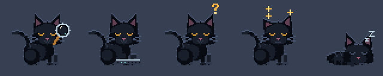

<div align="center">

# CLUI

### Give your agent a Linux desktop.

See the screen. Find the control. Take the action. Check what changed.

[](https://github.com/cons0leweb/CLUI/actions/workflows/ci.yml)


[](LICENSE)

[Quick start](#quick-start) · [Tools](#what-your-agent-can-do) · [Execution model](#actions-with-context) · [The cat](#meet-clui-pet) · [Reference](docs/tool-reference.md)

</div>

**CLUI — Codex Linux UI Interaction** is a local MCP server for working with real
Linux applications. An MCP client can inspect windows, read accessibility data,
click controls, type, scroll and verify the result with another observation.

It works across the X11 desktop: editors, dialogs, creative tools, browsers and
games. Applications with useful accessibility data get semantic targets. Games
and custom canvases can still be inspected through screenshots.

```text
      observe             act              observe again
   screenshot +       conditions +         what actually
   accessibility      authorization           changed
        └───────────────────┴────────────────────┘
```

Desktop interaction is the whole job. Terminal, Git and LSP belong to other MCP
servers. CLUI uses stdio, fixed desktop utilities and AT-SPI; it requires neither
a browser driver nor the Computer Use API.

## What your agent can do

| Capability | What it gives you |
| --- | --- |
| **See the desktop** | Screenshots of screens, windows or regions, returned directly as MCP images. |
| **Understand controls** | ScreenMap overlays numbered targets on AT-SPI controls and exposes their names, roles and states. |
| **Interact** | Mouse movement, clicks, dragging, keyboard input, clipboard access and scrolling inside containers. |
| **Manage windows** | Find, focus, move, resize, minimize, maximize and inspect windows and popup surfaces. |
| **Use semantic actions** | Discover and invoke an element's supported AT-SPI actions with explicit authorization. |
| **Run checked sequences** | `desktop_act` uses the same execution rules as individual tools, checking every step. |
| **Show activity** | A click-through cursor ring labels the current action and target. An optional cat keeps you company. |

[Browse the complete tool reference →](docs/tool-reference.md#tools)

## Quick start

You need **Linux with an X11 session** and **Node.js 20+**. Native Wayland is not
supported. Start CLUI as the same user as the desktop, with access to `DISPLAY`
and, when required, `XAUTHORITY`.

### 1. Install desktop utilities

On Debian / Ubuntu:

```bash
sudo apt install xdotool x11-utils x11-xserver-utils imagemagick maim
```

Optional features:

```bash
# Clipboard, maximize/restore, and accessibility data
sudo apt install xclip wmctrl at-spi2-core

# Optional screenshot fallback
sudo apt install scrot
```

The cursor activity indicator also needs `python3`, `libX11.so.6`, `libXext.so.6`
and `libXft.so.2`. It disables itself if unavailable. **CLUI Pet is a separate
TypeScript addon** and does not use Python or Electron.

### 2. Build CLUI

```bash
git clone https://github.com/cons0leweb/CLUI.git
cd CLUI
npm ci
npm run build
```

`npm start` runs the MCP server. stdout carries MCP messages; logs go to stderr.

### 3. Connect your MCP client

For Codex, add this table to `~/.codex/config.toml`. Replace
`/absolute/path/to/CLUI` in both places with your clone's absolute path:

```toml
[mcp_servers.clui]
command = "node"
args = ["/absolute/path/to/CLUI/dist/index.js"]
cwd = "/absolute/path/to/CLUI"
env_vars = ["DISPLAY", "XAUTHORITY", "XDG_SESSION_TYPE", "WAYLAND_DISPLAY"]
startup_timeout_sec = 10
tool_timeout_sec = 60
```

Copyable file: [examples/codex.config.toml](examples/codex.config.toml).
Other MCP clients can launch the same Node entry point over stdio.

Restart the client, then call **`desktop_get_capabilities`**. It reports the
session, available utilities and the action session ID used for mutations.

Try asking your agent:

> Look at the active application and describe what you see. Don't interact yet.

Then, with a specific target:

> Find my editor, focus its window and inspect the available controls.

## Actions with context

Every mutating request carries a `session_id` and a caller-generated `request_id`.
Input actions also need an expected target window. For example,
`desktop_type_text` accepts:

```json
{
  "session_id": "<action_session_id from desktop_get_capabilities>",
  "request_id": "search-001",
  "expected_window_id": "0x4600007",
  "text": "black cats with amber eyes"
}
```

Use an actual window ID from your session. CLUI checks the target before
permission checks, again after any human confirmation, and immediately before
backend input dispatch.

```text
MCP tool / desktop_act step
  → validate conditions
  → ActionGuard / human approval when required
  → revalidate conditions and focus
  → X11 or AT-SPI dispatch
  → dispatch result + separate observation
```

- **Unknown state blocks input.** A mismatch and an unreadable condition have
  distinct structured results.
- **Human approval comes from the client.** An agent cannot authorize itself
  with `confirmed: true`. Unsupported confirmation channels block the action.
- **Uncertain input is never silently retried.** A possible partial dispatch
  produces `outcome_unknown` and requires a fresh observation before another mutation.
- **Duplicate delivery does not repeat the action.** Matching request IDs return
  their retained result within the current server session.
- **Dispatch is not success.** Backend acknowledgment and what was observed
  afterward remain separate facts.

This is a local desktop controller with the permissions of its user. Keep it off
network transports. Classification cannot understand every consequence of a
coordinate click, and X11 focus checking and input injection are not atomic.

[Execution contract and limits](docs/action-execution.md) ·
[Approval, replay and privacy details](docs/tool-reference.md#security) ·
[Report a vulnerability](SECURITY.md)

## Meet CLUI Pet

A tiny black cat with amber eyes. It walks along window edges, rides moving
windows, jumps, stretches, grooms and curls up to sleep. When a supporting window
closes, gravity takes over.

<div align="center">



*Observing · Typing · Waiting for you · Confused · Taking a nap*

</div>

The preview uses the actual TypeScript animator. On the desktop, the cat lives in
a transparent, click-through X11 overlay that does not take focus. Its idle
behavior works even when CLUI is not running.

```bash
npm run pet:start
npm run pet:status
npm run pet:stop
```

To enable reactions to CLUI activity, add this to the MCP server configuration
and restart the server:

```toml
[mcp_servers.clui.env]
CLUI_VISUAL_EVENTS = "1"
```

The cat receives a bounded, one-way stream of cosmetic events. CLUI never waits
for it or reads decisions from it. The pet cannot approve actions, send input or
change execution policy. Typed text, screenshots and window titles are absent
from its event payloads.

**TypeScript + a pure JavaScript X11 client.** No Electron, native compilation or
Python in the pet. Start and stop it independently. Inspired by
[Clawdling](https://github.com/Loadercode/Clawdling), with original artwork and code.

[Pet setup, physics, isolation and resource measurements →](docs/clui-pet.md)

## Know the boundaries

- **X11 only.** A Wayland-only session is detected and reported, but cannot be controlled.
- **Accessibility varies.** ScreenMap reads AT-SPI, not OCR. Games, canvases and
  inaccessible controls can return no semantic elements; screenshots remain available.
- **Observe after changes.** Element IDs belong to short-lived snapshots. Layout
  changes, scrolling and uncertain outcomes call for a fresh observation.
- **Your window manager has a say.** Activation and geometry requests may be
  constrained or rejected.
- **The desktop is shared.** CLUI serializes its own mutations; physical input and
  other processes can still change focus or application state.

[Troubleshooting and platform details →](docs/tool-reference.md#troubleshooting)

## Development

```bash
npm run dev          # Run from TypeScript
npm run build        # Compile and package helper assets
npm test             # Unit and MCP contract tests; no display needed
npm run smoke        # Read-only checks against your X11 desktop
npm run pet:smoke    # Pet integration checks using temporary X11 windows
```

Stop a running pet before `pet:smoke`. Its fixture windows are removed afterward.
CI builds and tests on Node.js 20 and 22; interactive X11 checks run locally.

| Read next | Contents |
| --- | --- |
| [Tool reference](docs/tool-reference.md) | Tool names, arguments, ScreenMap, cursor indicator and troubleshooting. |
| [Execution contract](docs/action-execution.md) | Preconditions, authorization, uncertain outcomes and request retention. |
| [CLUI Pet](docs/clui-pet.md) | Standalone lifecycle, animation, desktop physics and one-way telemetry. |
| [Contributing](CONTRIBUTING.md) | Setup, ownership boundaries and contribution checks. |

Built for the desktop you already use. [MIT licensed](LICENSE).
