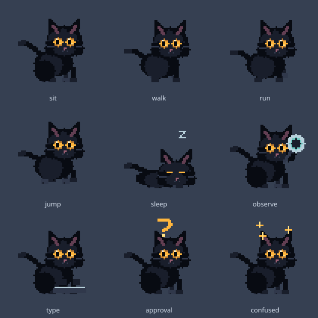

# CLUI Pet (optional, Linux/X11)



CLUI Pet is a standalone TypeScript/Node.js desktop companion: a small black pixel
cat with amber eyes. It has no MCP tools, input injection, approval buttons,
credentials, or connection to the action executor. It never clicks, types, focuses
windows, authorizes requests, or returns a decision to CLUI.

The concept is inspired by [Clawdling](https://github.com/Loadercode/Clawdling).
The cat artwork, animation and implementation here are original. No Clawdling code
or assets are included.

## Install and launch

Use Linux with an X11 session, Node.js 20+ and access to `DISPLAY`/`XAUTHORITY`.
The only addon dependency is the optional `x11` npm package: a pure JavaScript
X11 protocol client, without Electron, native compilation, Python or GTK.
X11 SHAPE 1.1 and a 24/32-bit TrueColor screen are required. A compositor is not
required; transparency uses the window's visible shape, rather than a black or
opaque rectangular background.

```bash
npm install
npm run build
npm run pet:start
npm run pet:status
npm run pet:stop
```

After installing the npm package, the equivalent commands are `clui-pet start`,
`clui-pet status`, `clui-pet stop`, and `clui-pet run` (foreground).

```bash
npm run pet:run -- --scale 2 --duration 60
npm run pet:start -- --scale 3 --port 47672
```

Scale is an integer from 1 to 4 (default 2). Duration is in seconds; zero means
no automatic stop. `--seed 18` makes idle choices reproducible for tests and recordings.
There is no autostart configuration or automatic download.
Missing optional dependencies do not stop the MCP server; only the pet fails to
start. If installed with `--omit=optional`, install `x11@4.4.0` to enable the pet.

Logs and the status/stop control socket live in a private directory beneath
`$XDG_RUNTIME_DIR` (fallback `/tmp/clui-pet-<uid>`), separated by X11 display.
The launcher reports the log path. The background process can be stopped without
stopping or restarting CLUI. The pet also runs normally when CLUI is absent.

## Opt-in CLUI events

Start the MCP server with these environment variables (restart it after changing
the environment):

```bash
CLUI_VISUAL_EVENTS=1 npm start
```

For a configured MCP launcher, add them to its environment:

```toml
[mcp_servers.clui.env]
CLUI_VISUAL_EVENTS = "1"
CLUI_VISUAL_EVENT_PORT = "47671"
```

The port defaults to 47671 and must match `--port` on the pet. The publisher is
disabled unless `CLUI_VISUAL_EVENTS=1`. It neither imports the pet nor starts it.

Messages are one-way, best-effort UDP datagrams to `127.0.0.1`. There is no reply,
handshake, acknowledgement, retry, subscription, or wait for pet readiness. At
most eight sends may be outstanding; further events are dropped. Network errors
are contained inside the visual publisher. Killing, pausing, or failing to launch
the pet cannot grant approval or change execution outcomes. A stalled receiver
only loses visual reactions.

The payload contains only `version`, an allowlisted `kind`, `phase`, timestamp,
process ID and sequence number. No tool arguments, typed text, clipboard contents,
window titles, accessible names, screenshots, request IDs or approval tokens are
sent. The receiver discards stale, duplicate, oversized and malformed messages
and drains a bounded queue. Local processes can spoof cosmetic events; the stream
is not an authorization channel. The separate local status/stop socket belongs
only to the pet, never to CLUI.

Reactions:

| Activity | Appearance |
| --- | --- |
| Observation/read | Magnifying glass, attentive eyes |
| Text/key input | Alternating paws over a tiny keyboard |
| Click | Anticipation crouch, physical hop, squash on landing |
| Waiting for human approval | Amber question mark; never an approval button |
| Error/blocked/uncertain outcome | Confused cat with circling stars |
| No events | Roaming, walking/running, grooming, stretching, blinking, sleep |

Reactions visualize requests/activity, not proof that an action succeeded.
They expire if an event is lost; approval has a 40-second visual ceiling. The
actual approval policy and its timeout are unchanged. Batch actions publish
cosmetic step events through the same independent publisher.

## Motion and desktop interaction

The pet reads mapped EWMH windows on the current workspace, frame extents,
stacking order and docks. Exposed top-edge intervals become platforms; edges
covered by higher windows are removed. Xinerama supplies individual monitor
floors, with root-screen fallback. A top edge must leave room for the cat above
it, so maximized windows whose top edge is against the screen edge cannot be
perches. Panels near the bottom of the display are walkable.

A supporting window carries the cat when moved. Resizing, minimizing, changing
workspace, covering or closing its foothold removes support and gravity takes
over. Reachable neighboring windows use a ballistic jump, with anticipation,
acceleration, four-foot gait phases tied to distance, tail inertia, landing
compression and exponential pose blending. Large frame delays use bounded
physics substeps instead of tunnelling through platforms. Idle behavior is
random; the pet cannot climb an arbitrarily tall gap from the floor.

Rendering is pixel art drawn by TypeScript directly into an X11 pixmap, then
copied to a shaped override-redirect window. The input shape is permanently empty
and the focus hint is false. The overlay is excluded from normal CLUI window and
surface lists. Geometry reads are event-triggered with a 500 ms fallback poll;
rendering is capped near 30 FPS and reduced to 10 FPS during sleep. Unchanged
pixel frames are not uploaded. Node.js itself has a memory baseline; this is not
a claim of a tiny native-binary memory footprint.

On the development X11 desktop, a 10-second idle animation sample at scale 2
used about 5.5% of one CPU core and 81 MiB RSS. This short sample is an observation,
not a resource ceiling; window count, animation state and hardware affect usage.

Native Wayland, dragging/clicking the cat, interactive menus, sound, physical
collisions with application content, and arbitrary non-EWMH popup surfaces are
not implemented. The cat is intentionally click-through. It has no persistent
behavioral history and reads window geometry, not application contents.

## Verification

```bash
npm run build
npm test
npm run pet:smoke
```

Unit tests run without a display. The X11 smoke test requires `xdotool` for
restoring the original input focus, creates only its own fixture windows and
closes them afterward. Stop an existing pet before running it. It checks the
empty input shape, focus preservation, window riding, falling/landing on close,
and live UDP reactions. Deterministic physics tests separately cover ballistic
cross-window jumps, reachability and occlusion; autonomous timing remains random.
